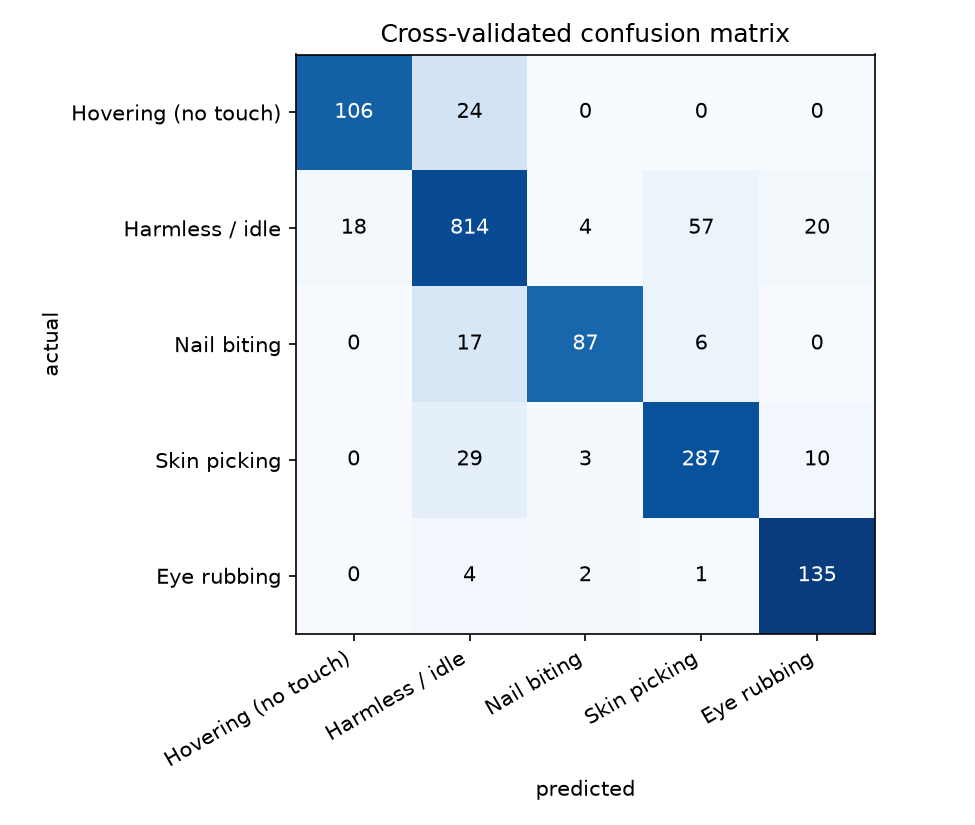
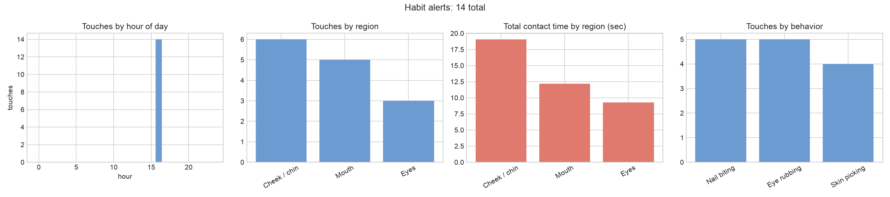

# Hand-to-Face Tracker

A real-time webcam tool that detects when your hands touch your face (nail biting, skin picking, eye rubbing) and nudges you in the moment. It runs fully on your own machine. No video is saved or sent anywhere.

<!-- add a demo GIF here:  -->

## Results

**Offline (5-fold cross-validation, grouped by clip).** 297 recorded clips, 1,624 one-second windows: 177 harmless/idle, 69 skin picking, 26 eye rubbing, 18 nail biting, 7 hovering. Habit vs. not-habit:

| Method | Precision | Recall | F1 | Hovering flagged as habit | Harmless / idle flagged as habit |
| --- | --- | --- | --- | --- | --- |
| Rule-based (distance threshold) | 44.3% | 91.9% | 59.8% | 88.5% | 60.9% |
| Rule-based + calibration | 43.8% | 85.0% | 57.8% | 70.8% | 59.3% |
| Classifier | 86.8% | 91.4% | 89.0% | 0.0% | 8.9% |

Five-class accuracy is 88.0% (macro F1 86.1%). Per class, precision / recall: nail biting 0.91 / 0.79, skin picking 0.82 / 0.87, eye rubbing 0.82 / 0.95, hovering 0.85 / 0.82, harmless / idle 0.92 / 0.89.



The live test below used a model trained on an earlier, smaller snapshot of the data (278 clips). On that snapshot the same cross-validation gave habit precision 89.6%, recall 89.9%, and F1 89.8%. A shift of a point or two after adding 19 clips is normal run-to-run variation at this data size.

**Live test on a separate day.** Each run follows the same scripted routine (`tracker.py --routine`), which prompts every action on screen and records the marked touches automatically: 21 habit touches (nail biting, eye rubbing, skin picking) and 20 everyday actions (hovers, sips, glasses or hair adjustments, chin rests, reaching past the face), 3 seconds each with 3 seconds of hands-down rest in between, about 4 minutes per run.

| Run | Real touches | Alerts matching a real touch | False alarms | Missed touches | Precision | Recall |
| --- | --- | --- | --- | --- | --- | --- |
| Rule-based, no calibration | 21 | 21 | 13 | 0 | 61.8% | 100% |
| Rule-based, auto calibration | 21 | 21 | 11 | 0 | 65.6% | 100% |
| Classifier | 21 | 13 | 1 | 8 | 92.9% | 61.9% |



These results are for the default settings in `config.py`.

**What this shows**

- The classifier flags far fewer harmless actions than a distance rule can. Offline, false flags on harmless contact and idle drop from 61% to 9%, and precision rises from 44% to 87%, with recall about the same (92% vs. 91%).
- In the live test, the rule-based tracker caught every real touch but also alerted on 11 to 13 of the 20 everyday actions. With the classifier, false alarms dropped to 1.
- Inside the classifier run, the contact detector produced 26 events. The classifier let 13 of the 14 that were real touches through and held back 11 of the 12 that were not.
- The classifier run missed 8 of 21 real touches, but only 1 of those was the classifier's decision. The other 7 never reached it: 3 were rejected by the hand-size check and 4 had only brief, flickering contact. All 7 fell between the 4th and 13th marked touch, and detection was steady after that, which points to the auto-calibrated hand-size baseline starting off wrong in that run (the per-touch diagnosis is in `diagnosis.csv`).
- Calibration alone helped little. Offline, hover false flags only fell from 88.5% to 70.8%, and live, false alarms only fell from 13 to 11. A sip or a chin rest really is a touch, so only the classifier can tell it apart from a habit.

**Read these numbers with care.** One person recorded all clips and the live test, in the same room with the same camera (the test was on a different day than the training clips). Hovering has only 7 clips. The live test has 21 touches, so its percentages have wide error bars. Each marked touch in the live test lasted 3 seconds. Frame rate was 19 to 22 fps. The evaluation allows 2 seconds of slack around each marked touch, and each alert can match only one marked touch. Two earlier pilot rounds, with touches marked by hand, are not reported: their pacing differed between runs, which is why the scripted routine was built.

## How it works

```
webcam -> MediaPipe Hands + Face Mesh -> touch detection -> filtering -> alerts / logs -> dashboard
```

1. **Landmarks.** MediaPipe gives 21 points per hand and 468 points on the face for every frame.
2. **Touch detection.** A fingertip (or the joint below it) counts as touching if it is within a small fraction of face width from a face landmark. Using face width as the unit means it works at any distance from the camera.
3. **Region.** The nearest landmark decides the region: eyes, nose, mouth, forehead, or cheek/chin.
4. **Filtering.** A touch only counts after it lasts about half a second, and gaps shorter than 0.2 seconds don't split one touch into many events. Both are set in seconds, so they don't depend on the camera's frame rate.
5. **Hover rejection.** A single camera only sees 2D, so a hand floating in front of the face looks like a touch. The tracker learns how big your hand looks when it is really on your face, and ignores a hand that looks noticeably bigger than that, since it is closer to the camera. This calibrates itself after a few seconds of touching your face. Pressing `C` sets it by hand instead.
6. **Alerts.** A different sound for each region. If it happens 3+ times in 10 minutes, you also get a desktop notification.
7. **Optional classifier.** A random forest on a 1-second window of movement decides whether a contact is a habit or harmless (see below).

## Setup

Tested with Python 3.11. MediaPipe 0.10.14 isn't available for the newest Python versions, so use a separate environment.

```
conda create -n tracker python=3.11 -y
conda activate tracker
pip install -r requirements.txt
python tracker.py
```

On macOS, allow camera access for your terminal app the first time.

## Quick test without the classifier

The classifier is optional. To try the rule-based tracker and measure it with the scripted routine:

1. Run `python tracker.py --no-autocal --routine --data data_nocal`, press `SPACE`, and follow the prompts. Press `Q` when it says the routine is finished.
2. Run `python tracker.py --routine --data data_auto`. Touch your face until the bottom message changes, then press `SPACE` and follow the prompts.
3. Run `python compare.py data_nocal data_auto` to compare the two runs.

## Controls

| Key | Action |
| --- | --- |
| `C` | Calibrate by hand (optional): press while your hand is really touching your face |
| `S` | Snooze alerts for 10 minutes (press again to cancel) |
| `G` | Mark a real touch (press at the start and end, used for evaluation) |
| `F` | Show or hide the face outline |
| `X` | The last few seconds were not a habit (saves a training example) |
| `B` `P` `E` | The last few seconds were nail biting / skin picking / eye rubbing (saves a training example) |
| `T` | Retrain the classifier from your saved examples (runs in the background) |
| `M` | Switch the classifier between gating alerts and just watching |
| `Q` | Quit and print a session summary |

## Files it creates (in `data/`)

- `events.csv`: every detected touch (start time, region, behavior, whether it alerted, duration)
- `sessions.csv`: one row per run (length, touches, total contact time, longest touch, top region)
- `labels.csv`: touches you marked with `G` (or that the routine marked)
- `diagnosis.csv`: what happened to each marked touch
- `dashboard.png`: charts from `python dashboard.py`

Training clips go in `dataset/` and the trained model is saved as `model.joblib`. Both are in `.gitignore`, since they are derived from your own face.

All settings (thresholds, sounds, snooze time, escalation rules) are in `config.py`.

## Evaluation

To measure accuracy:

1. Run `python tracker.py --data data_run1`.
2. Press `G`, do a real touch with one hand, press `G` again. Repeat about 20 times, using the other hand for the keyboard.
3. Also do things that should not count: hovering a hand near your face, adjusting glasses, reaching past your face.
4. Quit, then run `python evaluate.py data_run1`.

Each alert can match at most one marked touch, and each marked touch at most one alert. Anything that triggers an alert and matches no marked touch counts as a false alarm. With the classifier on, harmless contact is still logged in `events.csv` but doesn't alert, so it isn't counted.

For a repeatable test, run with `--routine`. The tracker prompts each action on screen with a countdown (3 seconds each, 3 seconds of rest between), records the habit touches as marked automatically, and ignores anything before you press `SPACE` to start or after the routine ends. Every run is then the same routine at the same pace.

When you quit after marking touches, the tracker also prints the average frame rate and explains what happened to each marked touch (hand not detected, rejected by the hand-size check, contact too brief, or alerted) and saves that as `diagnosis.csv`. Use it to see why touches are missed.

To measure the effect of calibration, do the same set of touches and hover tests in separate data folders: once with `python tracker.py --no-autocal --data data_nocal` (no calibration at all), once with the default automatic calibration, and optionally once pressing `C` yourself. Then `python compare.py data_nocal data_auto data_manual` prints all the runs as one table.

Results are in the Results section at the top. False alarms per hour is not reported, because the test runs are only a few minutes long, so a per-hour rate would be a large extrapolation.

## Behavior classifier

The rule-based detector can't tell a habit from harmless contact. Resting your chin on your hand or adjusting your glasses looks the same as nail biting if you only look at distance. The classifier looks at the last second of movement and decides what the contact is.

**How it works**

1. Every frame is turned into 57 numbers: hand position relative to the face, distances from the fingertips to the eyes, nose, and mouth, hand size, openness, pinch, and orientation.
2. A sliding window of 30 frames (about 1 second) is summarized with mean, std, min, and max of each number, plus motion features (fingertip speed, how often the hand changes direction, how long it stays near each region). That gives 236 features per window.
3. A random forest predicts one of five classes: hovering, harmless / idle, nail biting, skin picking, eye rubbing.
4. In the tracker, the classifier re-checks the last second every 10 frames (about half a second at 20 fps), and an alert fires only after it calls the contact a habit twice in a row. Setting `CLASSIFY_EVERY = 5` in `config.py` makes alerts a little faster, but that setting was not part of the live test. Harmless contact is still logged, but it never alerts.
5. An optional rule can sit on top of the model: nail biting needs fingers at the mouth, so when the hand has touched the face in the last second but never at the mouth, the model's nail-biting score is set to zero. One camera can't see whether fingers are inside the mouth, and without this rule a hand resting on the chin was sometimes called nail biting. It is off by default because the live test was run without it. Turn it on with `NAIL_BITING_NEEDS_MOUTH = True` in `config.py`. `train.py` reports its effect offline as "classifier + mouth rule".

**Collecting data**

```
python collect.py
```

Press `1` to `6` to pick a behavior, then `SPACE` to record a 15 second clip (after a 3 second countdown). Only landmark numbers are saved, never video. Touch your face for a few seconds first so it can auto-calibrate (the badge changes from "Calibrating" once it has).

| Key | Behavior | What to record |
| --- | --- | --- |
| `1` | Idle | Hands down, typing, reaching for things, hands far from the face |
| `2` | Hovering (no touch) | A hand held in front of the face, 5 to 15 cm away, not touching. Move it around, vary the distance |
| `3` | Harmless contact | Resting chin on hand, adjusting glasses, brushing hair, drinking, a single scratch |
| `4` | Nail biting | Fingers at the mouth with the usual back-and-forth motion |
| `5` | Skin picking | Pinching or picking motions on cheeks, chin, or forehead. Mimic it lightly, don't actually pick |
| `6` | Eye rubbing | Rubbing motion around one or both eyes |

Aim for at least 10 clips per behavior. Vary the hand you use, your distance from the camera, the lighting, and the time of day. Clips from different days are worth more than many clips from one sitting.

**Training**

```
python train.py
```

This cross-validates by clip (windows from the same clip never appear in both train and test), prints accuracy, per-class precision and recall, and a habit-vs-not comparison of four methods: the rule-based detector with no calibration, the rule-based detector with calibration, the classifier, and the classifier with the mouth rule. The last columns show how often hovering and harmless / idle windows were wrongly flagged as a habit. It also prints nail-biting recall with and without the mouth rule. It saves `confusion_matrix.png` and `model.joblib`. Behaviors with fewer than 2 clips are skipped, so you can start training before you have recorded all six. Idle and harmless contact are merged into one "harmless / idle" class by default, because the difference between them never matters for alerts and the two are easy to confuse (`MERGE_IDLE_INTO_HARMLESS` in `config.py`). Windows from habit clips where the hand never comes near the face are dropped, since they are really idle (`CLEAN_WINDOWS`).

**Using it**

```
python tracker.py --model
```

The panel shows the current prediction with its confidence. Logged events get a `behavior` column, and the dashboard adds a behavior chart.

The comparison with the rule-based detector is in the Results section at the top.

## Learning from corrections

Instead of recording training clips, you can teach the classifier while you use the tracker.

- When an alert goes off and it wasn't a habit, press `X`.
- When you catch yourself in a real habit, press `B`, `P`, or `E`, whether or not it alerted.
- Each press saves the last 3 seconds of landmark numbers (no video) into `dataset/`.
- Once you have at least 2 examples of a habit and 2 of not-a-habit, press `T`. Training takes a few seconds and runs in the background, so the camera keeps going.
- The new model starts in watching mode: the panel shows what it thinks, but alerts still follow the rule-based detector. Press `M` when you trust it, and it will only alert on touches it calls a habit. Press `M` again to go back.
- The model is saved as `model.joblib`, so `python tracker.py --model` picks it up next time.

Corrections and `collect.py` clips go in the same folder and are used together, so you can mix both.

## Design decisions

- **On-device only.** Frames are processed in memory and never stored, which matters for a camera that is pointed at your face.
- **Face width as the distance unit.** Thresholds scale with how far you sit from the camera.
- **Persistence and grace times.** Raw per-frame detection flickers. Requiring a touch to last and tolerating short dropouts gives stable events. These are in seconds rather than frames, because the camera and the models run at different frame rates on different machines.
- **Hand-size calibration for depth.** A cheap proxy for depth that needs no extra hardware.
- **Learning from corrections.** One keypress turns a mistake into a labeled training example, and a new model starts in watching mode so a weak model can't silently turn off your alerts.
- **Self-calibration.** The baseline is a running median of hand size during sustained, near-exact fingertip contact. Samples far from the current baseline are ignored, so hovering can't drag it off. Pressing `C` overrides it.
- **Keeping the last face position briefly.** When a hand covers the face, face tracking can drop for a few frames. Reusing the last position avoids missed touches.

## Limitations

- One camera can't measure depth, so hover rejection is a heuristic. It can still fail if you lean toward or away from the camera after calibrating.
- Touches that mostly hide the fingertips (for example, curled fingers) are harder to detect.
- Needs decent lighting and a face that is mostly visible.
- Evaluation is based on manual labels from one person.
- The classifier is trained on one person's mimicked behaviors, so it may not transfer to other people or to the real habit. Clips from the same sitting are correlated, so cross-validation numbers are optimistic. The live test was on a different day than the training clips, but with the same person, room, and camera.
- With the classifier on, alerts arrive about a second after contact starts, since it needs a window of movement. 
- The live test is small (21 marked touches, about 20 unmarked actions per run), so its percentages are rough.
- Corrections only capture moments you noticed, so the model sees few idle or hovering examples. Mix in clips from `collect.py` for those.
- Auto-calibration can start from a wrong baseline. In the live classifier run, 7 real touches were rejected before the classifier saw them, all between the 4th and 13th touch. Locking the baseline after a confirmed calibration is the next fix.
- Auto-calibration needs a couple of seconds of real face contact before it kicks in. Until then a looser size limit is used, so early hovers can be flagged. If the first thing you do is hover, the baseline can start off wrong, so touch your face first or press `C`.

## Project structure

```
tracker.py    main loop, event state, snooze, labeling, classifier gating
vision.py     camera and MediaPipe hand/face processing
detector.py   touch detection and region logic
features.py   landmarks -> per-frame and per-window features
collect.py    records labeled training clips
train.py      trains and cross-validates the classifier
alerts.py     sounds and desktop notifications
ui.py         hand skeleton and status panel drawing
storage.py    CSV logging and session summary
config.py     all settings
dashboard.py  charts from the logs
routine.py    the scripted test routine
evaluate.py   precision / recall from your labels
diagnose.py   explains why each marked touch did or didn't alert
compare.py    puts several runs side by side as a table
```
